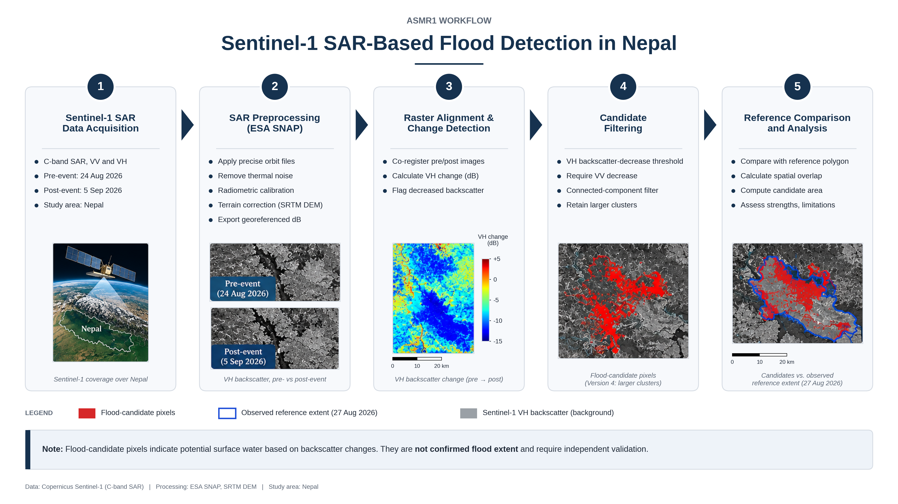
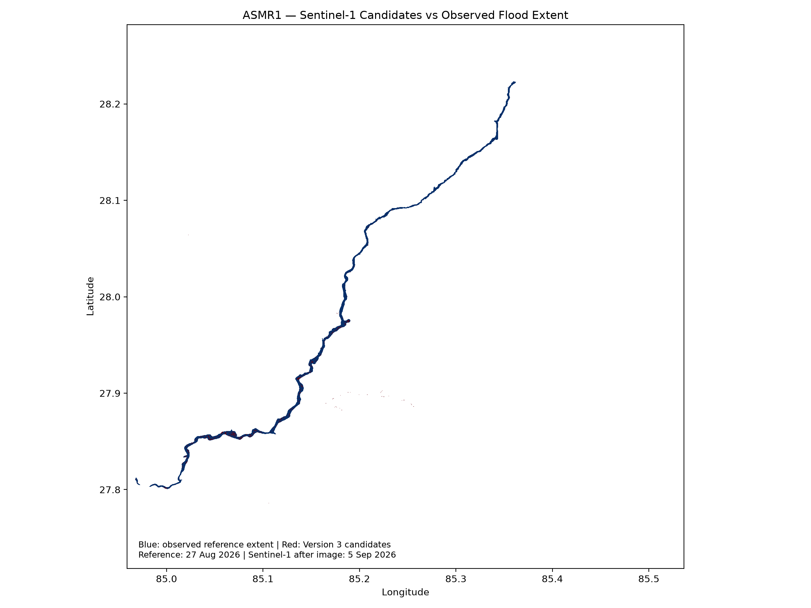
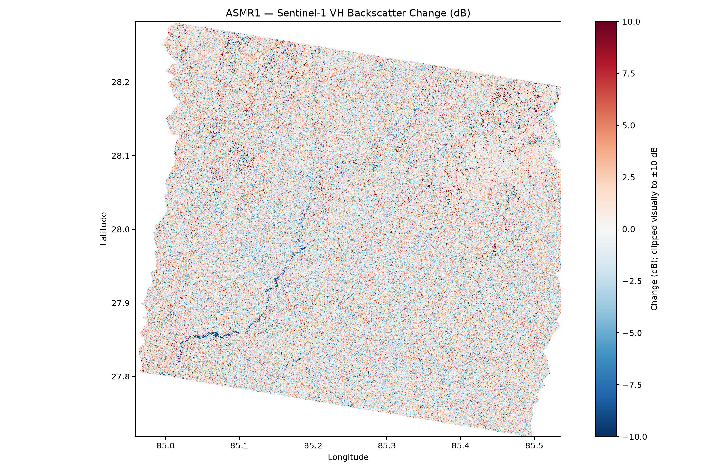
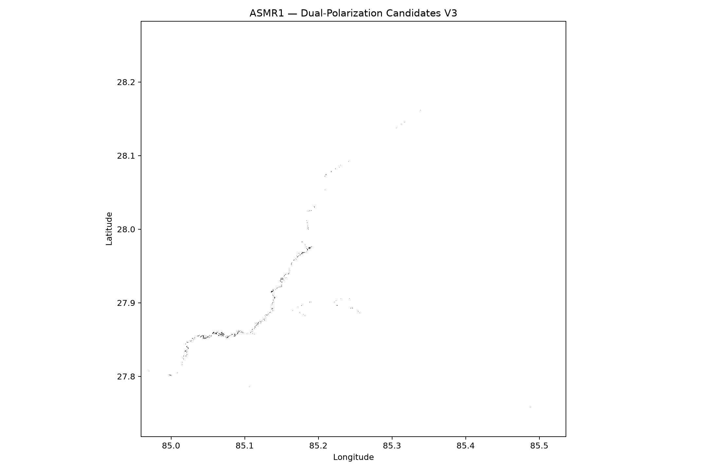
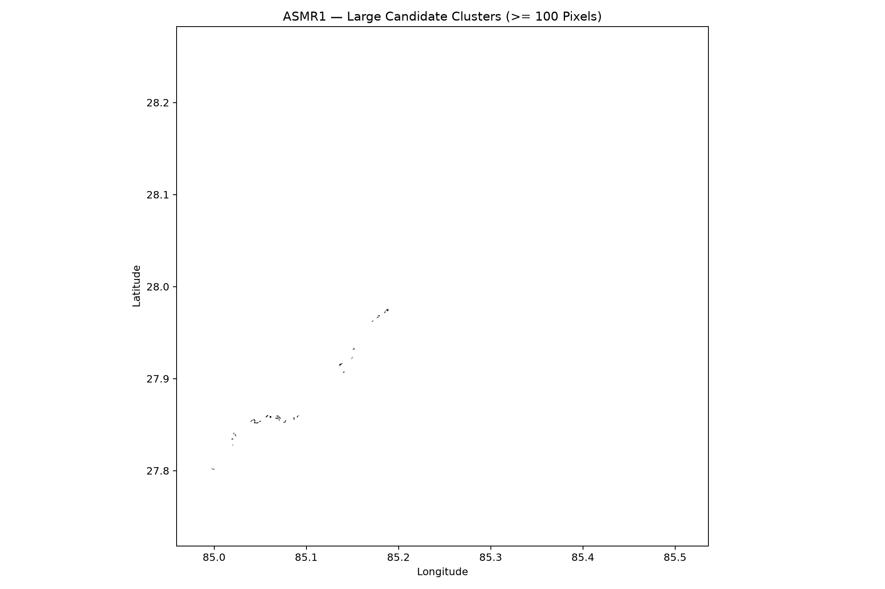

# ASMR1 — Mapping Flood Damage from Space

A satellite remote-sensing project investigating flood-related surface changes in Nepal using Sentinel-1 SAR imagery.

## Study data

- Pre-event Sentinel-1 acquisition: 24 August 2026
- Post-event Sentinel-1 acquisition: 5 September 2026
- Polarizations: VV and VH
- Study area: approximately 84.959–85.536° E, 27.718–28.282° N
- Processing: ESA SNAP GPT, terrain correction, and GeoTIFF analysis

## Workflow

1. Search for and verify Sentinel-1 products.
2. Preprocess SAR imagery using ESA SNAP.
3. Align before- and after-event rasters.
4. Calculate VH backscatter change in decibels.
5. Filter candidate changes using backscatter thresholds and connected components.
6. Compare candidates with an independent observed flood-extent reference.
7. Document spatial agreement, candidate area, and limitations.

## Preliminary results

- Version 1 candidates: 89,818 pixels.
- Version 2 candidates after connected-component filtering: 21,188 pixels.
- Version 3 dual-polarization candidates: 13,849 pixels.
- Approximate Version 3 candidate area: 1.5111 km².
- Candidate area inside the reference polygon: 1.4106 km².
- Candidate pixels inside the reference polygon: 93.35%.

These are preliminary candidate-change statistics, not validated flood-area or accuracy estimates.

## Important limitations

- The observed reference extent is dated 27 August 2026, while the post-event Sentinel-1 acquisition is dated 5 September 2026.
- The reference covers only part of the raster footprint.
- Low SAR backscatter and backscatter decreases can result from causes other than flooding.
- Spatial overlap with a reference polygon does not independently establish classification accuracy.
- Candidate areas should not be reported as confirmed flooded land without further validation.

## Project structure

```text
ASMR1/
├── run.py
├── requirements.txt
└── src/
    ├── data/
    │   ├── download_sentinel1.py
    │   ├── search_sentinel1.py
    │   └── verify_sentinel1.py
    └── processing/
        ├── inspect_product.py
        ├── inspect_radar.py
        ├── sentinel1_inspect.xml
        └── sentinel1_preprocess.xml
```

## Requirements

- Python 3
- Packages listed in `requirements.txt`
- ESA SNAP with GPT for SAR preprocessing
- Sufficient storage for satellite products and intermediate rasters

Activate the virtual environment and run:

```bash
source .venv/bin/activate
python run.py
```

On Fish shell, use:

```fish
source .venv/bin/activate.fish
python run.py
```

## Data policy

Raw Sentinel-1 archives, large rasters, SNAP output directories, virtual environments, and generated intermediate files are excluded from Git. Download source data separately and follow its applicable licensing and access terms.

## Status

Preliminary change detection and reference comparison completed. Independent validation of the flood classification remains future work.
```

Save and exit.

## Step 3 — Check your repository before the first commit

Run:

```fish
git status --short
```

Then:

```fish
git diff --check
```

The second command should produce no output if there are no whitespace errors.

## Results and Visualizations

### Project Workflow



The workflow covers Sentinel-1 data acquisition, SAR preprocessing, raster alignment, change detection, candidate filtering, and reference comparison.


The following figures show preliminary Sentinel-1 backscatter changes and flood-candidate detections over the study area in Nepal.

### 1. Reference Flood Extent and Candidate Detection



The overlay compares the observed flood-extent reference with the detected candidate pixels. Spatial overlap is encouraging, but it does not independently establish classification accuracy.

### 2. VH Backscatter Change



This figure shows the change in VH-polarized radar backscatter between the pre-event and post-event acquisitions. Backscatter changes can reflect flooding as well as other surface changes.

### 3. Dual-Polarization Flood Candidates — Version 3



Version 3 combines a VH backscatter-decrease threshold with a VV backscatter-decrease filter. The resulting pixels are candidate changes, not confirmed floodwater.

### 4. Larger Candidate Clusters — Version 4



Version 4 retains larger connected candidate clusters to help inspect spatial patterns and reduce isolated detections.

### Reference Comparison

The comparison report records the spatial agreement between candidate pixels and the observed reference polygon.

[View the reference comparison report](results/reports/reference_comparison.txt)

**Important:** The reference is dated 27 August 2026, while the post-event Sentinel-1 image is dated 5 September 2026. Results are preliminary and require further independent validation.
